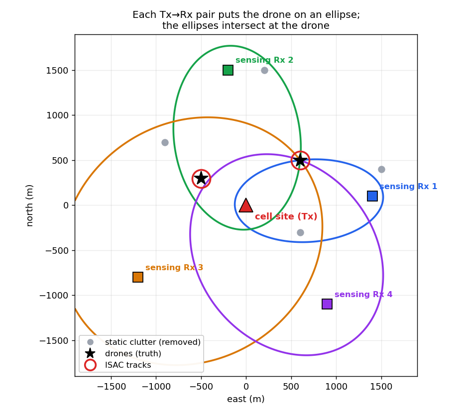
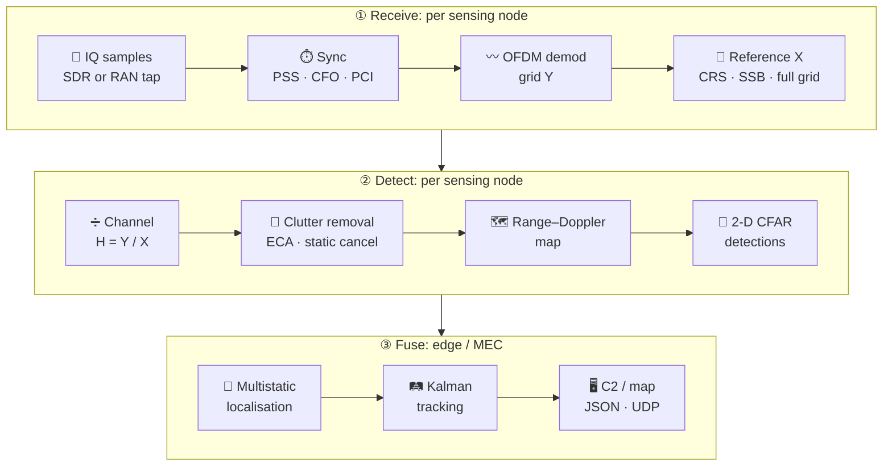
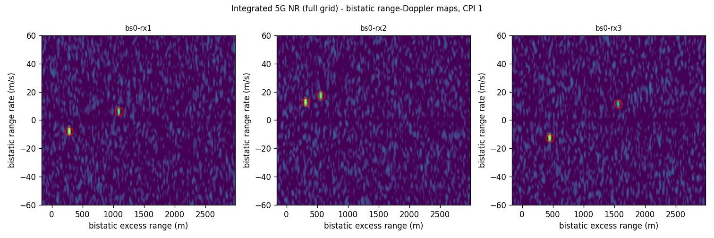
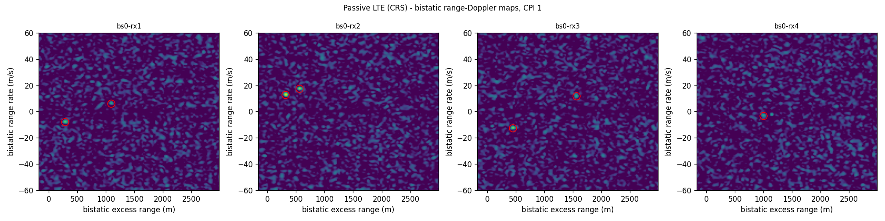
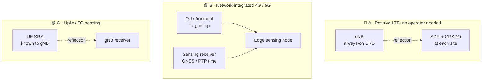
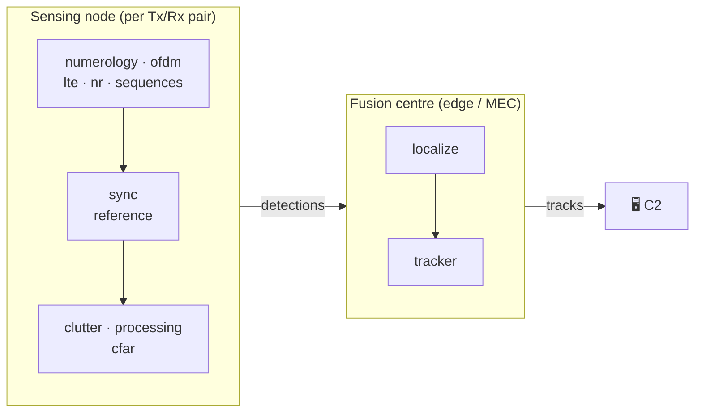

<div align="center">

# 📡 ISAC Counter-Drone

### Turn existing 4G / 5G cell towers into a silent drone-detection network

**Integrated Sensing and Communication (ISAC)**: detect, locate and track small drones
using the signals mobile networks already transmit. No new radars, no new spectrum, no new emissions.

[](https://github.com/ajisrawi/isac-counter-drone/actions/workflows/tests.yml)

-0A66C2)
-7B2FBE)


[How it works](#-how-it-works) •
[Quick start](#-quick-start) •
[Results](#-results) •
[Deployment modes](#-three-deployment-modes) •
[Network rollout](docs/NETWORK_IMPLEMENTATION.md) •
[Architecture](#-software-architecture)

</div>

---

## ✨ Why ISAC for counter-drone

| | |
|---|---|
| 🌍 **Nationwide by design** | Coverage follows the mobile network: cities, borders, airports, energy sites, stadiums. No new towers. |
| 🤫 **Silent** | Emits nothing. It cannot be located or jammed like a conventional radar. |
| 🛰️ **Sees "dark" drones** | Works on the drone's *echo*, so it also detects autonomous and fibre-optic drones that send no radio signal. |
| 💰 **Software-defined** | Runs on SDRs or inside the operator's RAN and edge cloud. Mostly software on infrastructure that already exists. |

---

## 🧭 How it works

A drone near a cell site reflects a tiny part of that site's downlink signal.
Every **Tx → Rx pair** measures two things per drone:

- 📏 **bistatic excess range** `ρ = R_tx + R_rx − baseline`, which puts the drone on an **ellipse** around the two sites
- 🏃 **bistatic range rate** `ρ̇` from the Doppler shift, which gives its **speed**

Three or more pairs make the ellipses intersect **at the drone**. A Kalman tracker then
turns those fixes into live tracks.

<div align="center">

</div>

### Signal chain



---

## 🚀 Quick start

```bash
git clone https://github.com/ajisrawi/isac-counter-drone.git
cd isac-counter-drone
pip install -e ".[dev]"

python -m pytest                                  # ✅ 11 tests
python -m isac demo nr  --plot nr.png             # 5G integrated: 1 gNB + 3 sensing receivers
python -m isac demo lte --plot lte.png            # 4G passive:    1 eNB + 4 SDR sites
```

<details>
<summary>📋 Example output (5G NR, 20 MHz @ 3.5 GHz, two 0.02 m² drones)</summary>

```text
[rx1] direct-path lag 1405 m, 2 detections
     uav1: truth   283.1 m  -7.98 m/s | det   283.0 m  -7.95 m/s SNR 30.8 dB
     uav2: truth  1093.2 m  +6.27 m/s | det  1092.9 m  +6.20 m/s SNR 25.6 dB
[rx2] direct-path lag 1513 m, 2 detections
     uav1: truth   557.4 m +17.49 m/s | det   557.7 m +17.46 m/s SNR 28.6 dB
     uav2: truth   310.3 m +12.83 m/s | det   310.6 m +12.79 m/s SNR 31.1 dB
...
t= 0.200s  fixes=2  confirmed tracks=2
   track 1: pos [-500.  297.   93.]  vel [ -7.  -11.    0.5]  -> uav2 horiz. error   1.3 m
   track 2: pos [603. 500. 112.]  vel [12.  -6.  -0.1]  -> uav1 horiz. error   1.0 m
```

</details>

---

## 📊 Results

Range–Doppler maps from the end-to-end simulator, with realistic link budgets, thermal
noise, static clutter and unknown receiver timing and frequency offsets.
🔴 circles mark CFAR detections.

**5G NR, network-integrated mode** (every transmitted resource element known):



**4G LTE, passive mode** (only the always-on CRS pilots regenerated, no operator cooperation):



| Scenario | Per-pair accuracy | Track accuracy |
|---|---|---|
| 🟣 5G NR integrated · 20 MHz · 40 ms CPI · 3 Rx | ≈ 0.3–1 m range · ≈ 0.05 m/s rate | ≈ **1 m** horizontal |
| 🔵 4G LTE passive · 10 MHz · 100 ms CPI · 4 Rx | ≈ 1–5 m range · ≈ 0.1–0.3 m/s rate | ≈ **2 m** horizontal |

> [!NOTE]
> These are **simulation** results: free space, point targets, ideal GNSS clocks, no birds.
> Expect several times worse in the field. Measuring that is the purpose of the field pilot in the
> [rollout guide](docs/NETWORK_IMPLEMENTATION.md).

---

## 🏗️ Three deployment modes



| | 🔵 **A · Passive LTE** | 🟣 **B · Integrated 4G/5G** | 🟢 **C · Uplink 5G** |
|---|---|---|---|
| Operator cooperation | none (reception only) | Tx IQ / grid tap | SRS configuration |
| Known signal | CRS, regenerated from cell ID | every transmitted RE | UE SRS |
| Processing gain (10 MHz, 100 ms) | ~46 dB | ~59 dB | config-dependent |
| Long-delay clutter cancellation (ECA) | ❌ | ✅ | ✅ |
| Entry point | `LtePassiveNode` | `TxTapNode`, `process_grids` | `process_grids` |
| Best for | fast pilots, covert sites | production national coverage | dense urban |

> [!TIP]
> 5G NR has no always-on reference signal like LTE's CRS, so **passive 5G is weak**: the SSB
> repeats only every 20 ms. For 5G, plan on mode **B** or **C** with the operator.

➡️ The **step-by-step network rollout** covers approvals, site planning, lab work, field pilot,
O-RAN fronthaul integration, RIC xApp configuration, KPIs and scale-out:
**[docs/NETWORK_IMPLEMENTATION.md](docs/NETWORK_IMPLEMENTATION.md)**

---

## 🛰️ Field use

```bash
# 1️⃣ Record at each site (GPSDO-locked SDR, native LTE sample rate)
python -m isac record --args "driver=uhd" --freq 2655e6 --rate 15.36e6 --seconds 30 --out rx1.cf32

# 2️⃣ Fuse all sites → JSON tracks on stdout, file and UDP (to a C2 / map display)
python -m isac run examples/config_lte_passive.yaml -v
```

<details>
<summary>🐍 Library use</summary>

```python
from isac import lte_carrier, SensingConfig, LtePassiveNode

num = lte_carrier(10, 2.655e9)                 # 10 MHz LTE, Band 7
node = LtePassiveNode("enb-rx1", num, SensingConfig(max_range_m=3000), cpi_s=0.1)

for cpi in node.process(iq_samples):            # complex64 @ 15.36 Msps
    for d in cpi.detections:
        print(f"{d.excess_range_m:7.1f} m  {d.range_rate_mps:+6.2f} m/s  {d.snr_db:4.1f} dB")
```

</details>

---

## 🧩 Software architecture



| 📁 Module | Role |
|---|---|
| `numerology.py` `ofdm.py` | LTE / NR frame structure, CP-OFDM |
| `lte.py` `nr.py` `sequences.py` | CRS, PSS, SS/PBCH block, Gold sequences (3GPP 36.211 / 38.211) |
| `sync.py` | Passive acquisition: PSS timing, CFO, half-frame, PCI search |
| `reference.py` | Which resource elements are known: CRS / SSB / full grid |
| `clutter.py` | ECA time-domain cancellation of direct path and static clutter |
| `processing.py` `cfar.py` | Range–Doppler map, 2-D CA-CFAR, detections |
| `localize.py` `tracker.py` | Multistatic localisation with ghost rejection, Kalman tracking |
| `pipeline.py` | Sensing nodes and fusion centre |
| `sim.py` `demo.py` | Physics-based simulator and end-to-end demos |
| `sources.py` `cli.py` | SDR recording (SoapySDR), file replay, JSON / UDP output |

---

## ⚠️ Status and limitations

- ✅ Full chain verified **in simulation**. 11 automated tests run on every push.
- 🔬 The LTE CRS and NR SSB generators follow the 3GPP formulas but have **not yet been validated
  against over-the-air captures**. That is the first lab task.
- 🐢 The Python code is a **reference implementation** and processes recordings offline.
  Real-time operation needs a GPU port of the FFT and DFT stages.
- 🚁 Known physical limits: **hovering drones** (zero Doppler) are suppressed together with clutter;
  **altitude** accuracy is poor with masts at similar heights; **birds** need a classifier (planned).

See section 5 of the [rollout guide](docs/NETWORK_IMPLEMENTATION.md#5-known-limitations-and-mitigations)
for each limitation and its mitigation.

---

<div align="center">

📡 Built for counter-drone protection over 4G / 5G networks in Jordan and the MENA region.

© 2026 · All rights reserved. No license is granted for reuse.

</div>
